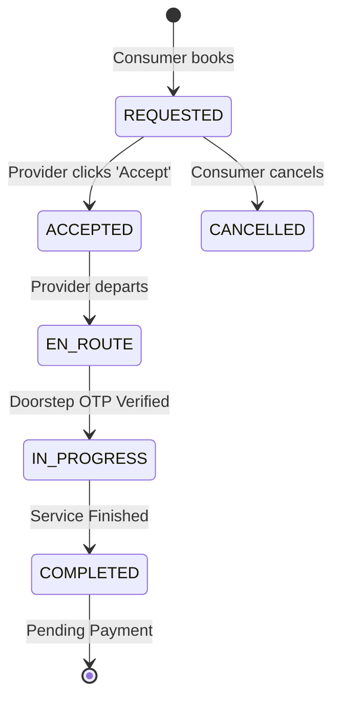

# Frontend Integration Guide: Urban Company Architecture

This document summarizes the recent architectural rewrite of the Eazyserv platform mapping it closer to an "Urban Company" style dispatch model rather than standard peer-to-peer directories.

> [!IMPORTANT]
> The Swagger (`/docs`) remains the source of truth for exact JSON schemas, but this document explains the **business flows** and **state machine lifecycles** required to build the Consumer and Provider apps correctly.

---

## 1. The Unified Global Catalog

Previously, you fetched "Services" belonging to specific Providers. This is no longer the case.

- **Global Services:** `GET /api/v1/services` now returns **Unified Catalog** items (e.g., "Standard AC Repair").
- **No Direct Provider Browsing:** Consumers no longer pick the provider. The platform dynamically matches them behind the scenes.
- You should dynamically render the UI based on global `categories` and `services`.

---

## 2. The dynamic Booking Flow (Fastest Finger First)

### For the Consumer App

When a consumer checks out:

1. Call `POST /api/v1/bookings` with `service_id`, `address_id`, and `scheduled_at`.
2. The booking is instantly created in the `REQUESTED` state with **`provider_id: null`**.
3. _Backend Action:_ The backend performs a PostGIS geofence scan and pushes real-time FCM notifications to all nearby verified providers who offer this service.
4. The frontend UI should switch to a "Searching for nearby partners..." polling state or listen for a notification webhook.

### For the Provider App (Partner App)

1. The Provider receives a push notification `event: "new_request"`.
2. The UI should display an incoming request card.
3. Call `PATCH /api/v1/bookings/{booking_id}/accept`.
   - **Success (200):** The backend atomically locks the booking. This provider has officially claimed the job!
   - **Failure (403 Unauthorized):** Someone else clicked accept first. Show an "Oops! Another partner claimed this request" state.

---

## 3. Booking State Machine Transitions

The lifecycle of a single booking flows strictly in this direction:



### Critical Endpoints for State Updates:

- **Departing:** `PATCH /api/v1/bookings/{booking_id}/en-route` (Partner starts driving/walking).
- **Starting Job:** `PATCH /api/v1/bookings/{booking_id}/start`
  > [!WARNING]
  > Requires `{ "otp": "xxxx" }`. The partner must ask the consumer for the secret 4-digit PIN generated at checkout (`doorstep_otp` located in the Consumer booking API response).
- **Finishing Job:** `PATCH /api/v1/bookings/{booking_id}/complete`

---

## 4. Real-time Maps & Location Tracking (WebSockets)

When the Booking state enters `ACCEPTED` or `EN_ROUTE`, live tracking begins.

### Provider App (Publishing)

Connect to the WebSocket at `wss://api.yourdomain.com/api/v1/tracking/provider?token={JWT_TOKEN}`.
Emit the partner's GPS location every 3-5 seconds:

```json
{
  "booking_id": "uuid-here",
  "lat": 19.076,
  "lng": 72.8777,
  "heading": 120.5
}
```

### Consumer App (Subscribing)

Connect to the WebSocket at `wss://api.yourdomain.com/api/v1/tracking/consumer/{booking_id}?token={JWT_TOKEN}`.
The map will instantly receive a stream of JSON blocks matching the exact payload above, allowing you to animate a marker moving down the street map towards the customer!
